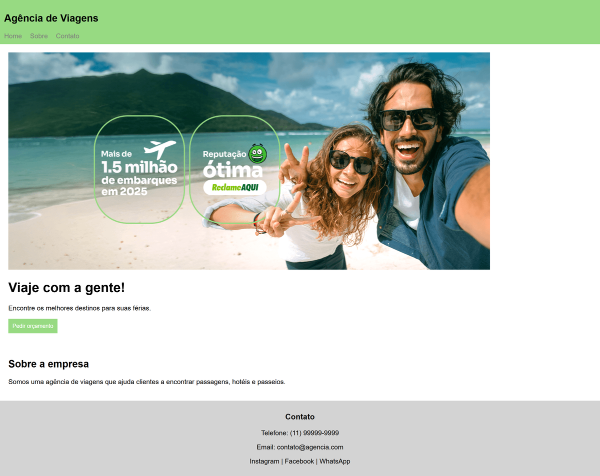

# pibblesite

[English](README.md) · Português

Landing page estática e curta de uma agência de viagens fictícia, desenvolvida em HTML e
CSS durante a aula de 01/06/2026.

Projeto em dupla com Emelize Bonfim ([@liz-whs](https://github.com/liz-whs)).

Não confundir com o [Pibble Express](https://github.com/ribasgiovanna/pibble_express),
a aplicação Django de gestão de entregas. Este é um exercício de aula separado.

**Site:** https://ribasgiovanna.github.io/pibblesite/

## Tecnologias

- HTML
- CSS

## Como abrir

Abra o `index.html` no navegador. Não há etapa de build nem dependências.
